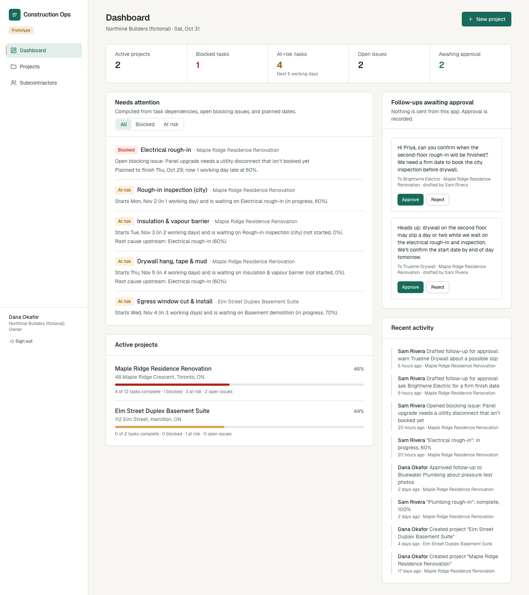
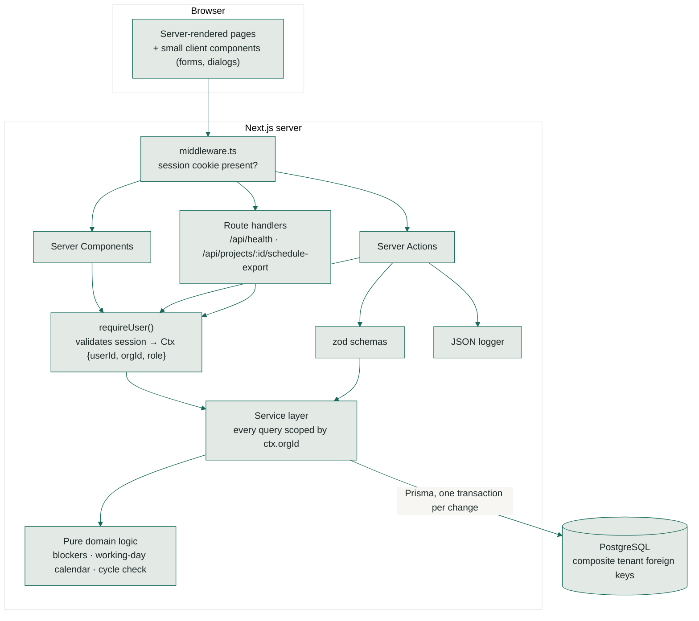
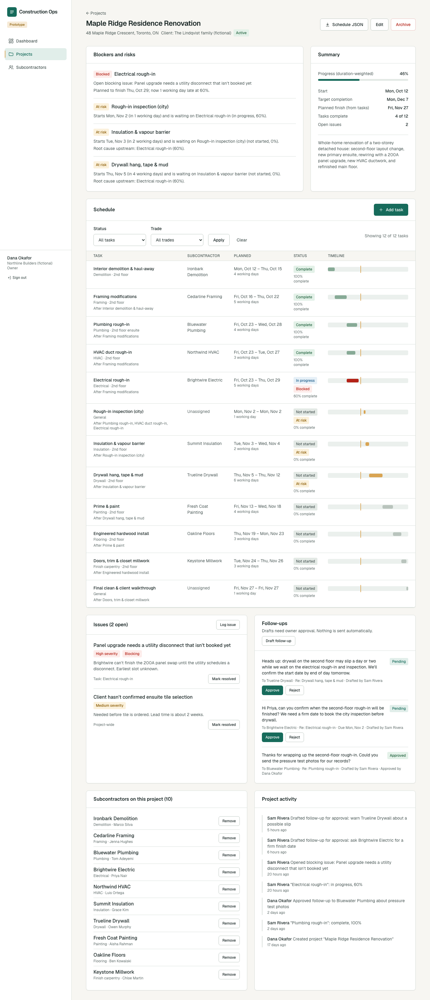
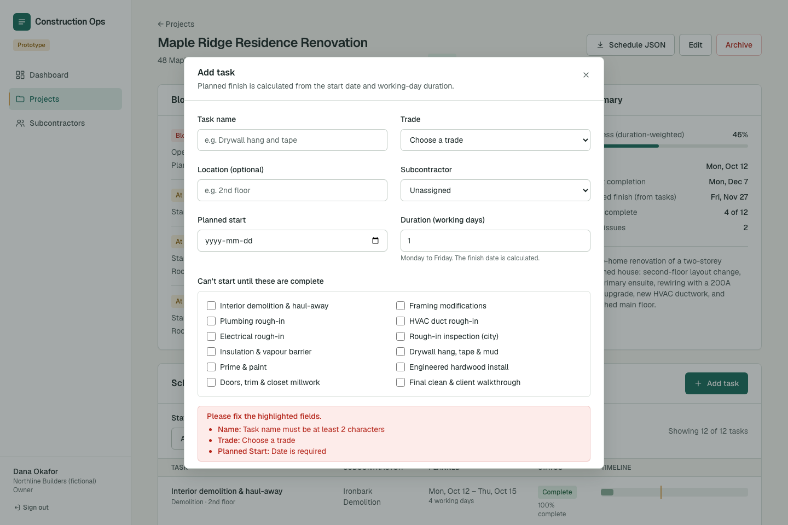
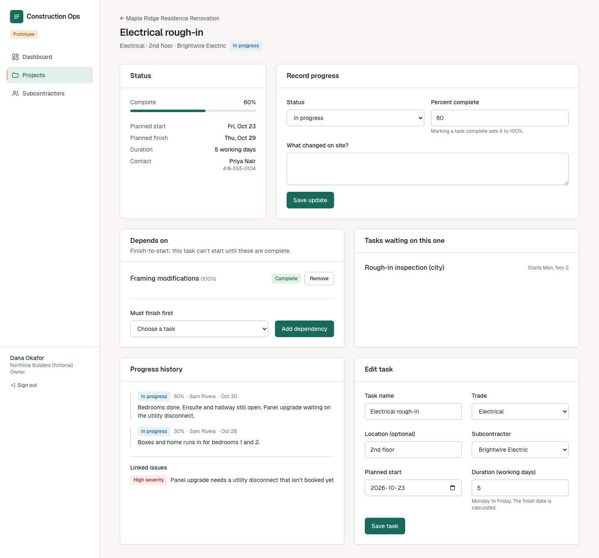
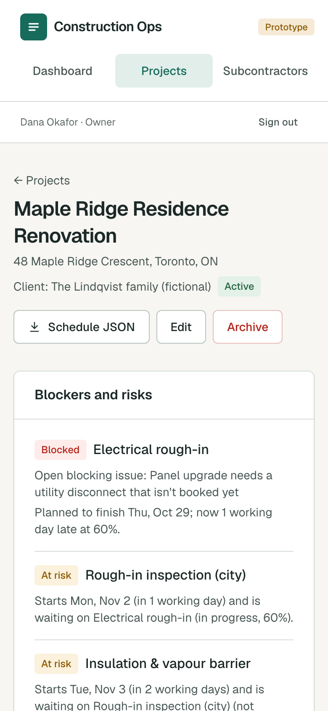

# construction-ops-platform

A full-stack web app for coordinating subcontractors on active construction projects. It shows which work is blocked, and why, before it costs a crew-day.

> **Open-source prototype.** Built as an engineering demonstration. It is not deployed, has no
> customers, and every company, person and address in the demo data is fictional.



## Quick start

```bash
docker compose up --build        # Postgres, migrations, demo data, app on http://localhost:3000
```

Sign in as `dana@northline.example` with the `SEED_DEMO_PASSWORD` from `.env.example`. Setup without Docker is under [Run it locally](#run-it-locally).

## The problem

A general contractor running a renovation spends much of the day chasing updates. Is the
electrician done on the second floor? Can drywall start Thursday? Did anyone book the
inspection? Those answers live in texts and memory. The expensive failure is learning on the
morning the drywall crew arrives that the walls can't be closed.

This project explores a narrow question: if tasks, dependencies and progress live in one
place, can the software tell the GC which upcoming work is at risk, and trace it to the
unfinished work that is actually holding it up?

## What it does

Every item below is implemented, stored in PostgreSQL, and covered by tests.

| Capability | Where to see it |
|---|---|
| Email and password accounts, database-backed sessions, protected routes | `/login`, `/signup` |
| Dashboard: blocked and at-risk tasks with root causes, approval queue, project progress, activity | `/dashboard` |
| Create, edit, search, archive and restore projects. Archived projects are read-only. | `/projects` |
| Company subcontractor directory with trade filter, added to individual projects | `/subcontractors`, project page |
| Tasks with working-day durations, finish-to-start dependencies and cycle prevention | project page, task page |
| Schedule timeline with server-side status and trade filters | project page |
| Progress updates (status, % complete, note) with history | task page |
| Issues, optionally marked as blocking a task | project page |
| Follow-ups drafted by anyone, approved or rejected only by an owner | dashboard, project page |
| Activity log written in the same database transaction as each change | everywhere |
| Role-based authorization: owners archive and approve, members draft and update | service layer |
| Tenant isolation between contractor companies, enforced twice | service layer and composite foreign keys |
| Schedule export in a shared JSON contract for `construction-dependency-engine` | `GET /api/projects/:id/schedule-export` |

### The scenario in the demo data

Plumbing rough-in is complete. Electrical rough-in is 60% done, a day late, and has a
blocking issue: the utility disconnect for the panel upgrade isn't booked. Drywall is
scheduled next, after the rough-in inspection and insulation. The dashboard shows:

- **Electrical rough-in: Blocked.** The open blocking issue, and how late it is.
- **Drywall hang, tape & mud: At risk.** It starts in 4 working days and waits on insulation.
  *Root cause upstream: Electrical rough-in (60%).*

Drywall's direct predecessor is insulation, not electrical. The blocker logic walks upstream
to the unfinished tasks whose own prerequisites are done, the ones someone can act on today,
so the superintendent calls the right subcontractor.

## Architecture



**A mutation, end to end** (recording progress on a task):

1. The form submits to a Server Action. Server Actions are public HTTP endpoints, so each one starts with no trust.
2. `requireUser()` hashes the session cookie, looks it up in Postgres, and builds `Ctx {userId, orgId, role}`.
3. A zod schema validates and normalizes the input. Errors come back as field-level messages.
4. The service opens a transaction, loads the task **by id and orgId**, checks the project isn't archived, writes the progress update and the task change, and writes an activity row. If any step fails, nothing is saved.
5. The page revalidates. Blockers are recomputed from the task graph on each request; they depend on today's date, so they are never stored.

**Data model:** `Organization` → `User`, `Project`, `Subcontractor`. `Project` → `Task`
(→ `TaskDependency`, `ProgressUpdate`), `Issue`, `FollowUp`, `ActivityLog`. Every
tenant-owned row carries `organizationId`, and child rows reference parents through
`(parentId, organizationId)` composite foreign keys.

## Tech stack and rationale

| Choice | Why |
|---|---|
| **Next.js 15** (App Router, Server Components, Server Actions) | One deployable for UI and backend; type-safe calls from forms to server code with no hand-written API layer |
| **TypeScript** (strict) | Shared types from the Prisma schema to the UI |
| **PostgreSQL 17 + Prisma 6** | Relational data with real constraints: composite foreign keys, enums, transactions. Prisma gives readable migrations and typed queries. |
| **zod 4** | Server-side validation with field-level errors |
| **Tailwind CSS 4** | Design tokens in one CSS file (`@theme`), shared with the docs (see [docs/DESIGN.md](docs/DESIGN.md)) |
| **Custom session auth** (scrypt + hashed tokens) | A few hundred lines, every security decision visible and testable. Trade-offs below. |
| **Vitest + Playwright** | Fast unit tests, integration tests against real Postgres, and browser tests against a production build |

## Screenshots

All screenshots are of the running application with the fictional seed data.

| | |
|---|---|
|  |  |
| Project: blockers, schedule filters and timeline (the vertical marker is today), issues, follow-ups | Add-task dialog after submitting an empty form: errors come from the server |
|  |  |
| Task: progress form, dependencies, history | Mobile layout |

## Run it locally

**Requirements:** Node.js 20.12 or newer, and PostgreSQL 15 or newer (or Docker).

### With Docker Compose

```bash
docker compose up --build
```

Then open http://localhost:3000. Compose starts Postgres, runs migrations and the seed, then the app.

### With a local PostgreSQL

```bash
cp .env.example .env
npm install
# create the role and databases named in .env, e.g. with psql:
#   CREATE ROLE ops_app LOGIN PASSWORD 'ops_local_dev' CREATEDB;
#   CREATE DATABASE construction_ops_dev OWNER ops_app;
#   CREATE DATABASE construction_ops_test OWNER ops_app;
npx prisma migrate deploy
npm run db:seed
npm run dev
```

On macOS: `brew install postgresql@17`.

### Environment

| Variable | Purpose |
|---|---|
| `DATABASE_URL` | App database |
| `TEST_DATABASE_URL` | Integration-test database. Its name must contain `test`, because the tests wipe it. |
| `APP_TIMEZONE` | Defines "today" for blockers (default `America/Toronto`) |
| `SEED_DEMO_PASSWORD` | Password given to the fictional demo users |
| `COOKIE_SECURE` | Optional. Overrides the `Secure` cookie flag (defaults to on in production) |
| `TRUST_PROXY` | Set to `true` only behind a proxy you control. Enables the per-IP login and sign-up limits; without it they're skipped, because the headers can be forged. |
| `TRUST_PROXY_HOPS` | How many proxies you control sit in front of the app (default 1, e.g. 2 for a CDN plus nginx). The client IP is read that many entries from the right of `X-Forwarded-For`, so values a client prepends are ignored. Invalid values fall back to 1. |

`.env` is gitignored. `.env.example` contains local-only development values.

## Demo walkthrough (about 3 minutes)

| Account (fictional) | Role | Shows |
|---|---|---|
| `dana@northline.example` | Owner | Everything, including approvals and archiving |
| `sam@northline.example` | Member | Can draft and update, can't approve or archive |
| `lee@granitepeak.example` | Owner of a different company | Tenant isolation |

The password for all three is `SEED_DEMO_PASSWORD` from `.env`.

1. Sign in as Dana. **Needs attention** shows electrical blocked and drywall at risk, with the root cause. Use the *Blocked / At risk* filter.
2. Open **Maple Ridge Residence Renovation**. Filter the schedule to *Blocked or at risk*. The red bar is the late electrical work; the amber line is today.
3. Open **Electrical rough-in** and record progress as *Complete*. Back on the dashboard, the risks move downstream and the root cause becomes the inspection.
4. Approve the follow-up to Trueline Drywall. It moves to *Approved* in the activity log.
5. Sign in as Sam. There are no *Approve* or *Archive* buttons, and the server rejects those actions if forced.
6. Sign in as Lee and open `/projects/prj_maple_ridge`. You get a 404, and the export API also returns 404.
7. On a project, click **Schedule JSON** and send it to `construction-dependency-engine` (see [docs/INTEGRATION.md](docs/INTEGRATION.md)).

## Tests

```bash
npm run lint && npm run format:check && npm run typecheck
npm test                              # unit + integration (needs TEST_DATABASE_URL)
npm run build && npm run test:e2e     # Playwright, headless Chromium, production build
```

| Suite | Covers | Last local result |
|---|---|---|
| Unit (68) | Working-day calendar (including weekend, zero-day and year-end edges), blocker detection and root causes, cycle detection, zod validation, password hashing, session tokens, bounded rate limiter, lockout resistance, client-IP parsing (forged X-Forwarded-For entries ignored), safe redirects (including browser URL clean-up tricks), every Server Action checked for a session | **68 passed** |
| Integration (25) | Real PostgreSQL: tenant isolation (8 tests, including a direct insert rejected by the composite foreign key), auth and sessions, per-IP login throttling, sign-up limits, dependencies and cycles, archive rules, owner-only archive and approval, search scoping, activity-log rollback, schedule export | **25 passed** |
| End-to-end (7) | Signed-out redirect, wrong password, dashboard blocker, create project with dialog validation → add task → archive via confirmation dialog, member restrictions, server-side schedule filters, other company gets a 404 page and API | **7 passed** |

Last local run: macOS, Node 25.9, PostgreSQL 17.11, 31 Oct 2026. CI runs the same suites on
Node 22 (Ubuntu 24.04) with a Postgres 17 service container, plus lint, formatting, a
runtime-dependency audit, and a Docker image build.

> The Docker image builds in CI. `docker compose up` itself has not been run, because Docker
> isn't installed on the development machine.

## API

Pages and Server Actions cover the UI. Two JSON endpoints exist:

```http
GET /api/health
→ 200 {"status":"ok","database":"ok"}
```

```http
GET /api/projects/prj_maple_ridge/schedule-export      (session cookie required)
→ 200 {"contract_version":"1.0","project_id":"prj_maple_ridge","start_date":"2026-10-12","as_of":"2026-10-31",
       "tasks":[{"id":"…","name":"Electrical rough-in","trade":"electrical","duration_days":5,
                 "status":"in_progress","percent_complete":60,"planned_start":"2026-10-23","depends_on":["…"]}, …]}
→ 401 without a session · 404 for another company's project
```

## Security considerations

| Concern | Implementation |
|---|---|
| Passwords | scrypt from Node's standard library, per-user salt, parameters stored in the hash, constant-time comparison |
| Account enumeration | Unknown emails still run one scrypt comparison, so timing doesn't reveal which accounts exist |
| Sessions | 256-bit random token in an `httpOnly`, `SameSite=Lax` cookie (`Secure` in production). Only its SHA-256 is stored. Seven-day expiry; deleted on sign-out. |
| Brute force | Per 15 minutes: 5 failures per IP + account, 30 per IP across accounts, and 20 per account from anywhere. One IP's guessing doesn't lock the real user out elsewhere. A determined attacker can still trip the account limit from 20+ IPs (documented residual risk). Counters are bounded in memory: expired windows are swept and the table is capped. |
| Client IP for limits | With `TRUST_PROXY=true`, the IP is the `X-Forwarded-For` entry `TRUST_PROXY_HOPS` places from the right (the one your own proxy added), never the leftmost, which a client can forge to dodge per-IP limits |
| Account enumeration at sign-up | Sign-up says when an email is already registered, so it can reveal that an account exists. A real product would show a neutral message and email the address; this prototype sends no email, so it keeps the clear message and limits sign-up attempts to 10 per IP per hour. |
| Authorization | Middleware only checks that a cookie exists. `requireUser()` validates the session on every page, action and API route. Owners alone can archive, restore and approve; this is enforced in the service layer, not by hiding buttons. A unit test parses every `"use server"` file and fails if an exported action doesn't call `requireUser()`, apart from an explicit allow-list (sign-up, login, logout). |
| Tenant isolation | (1) Every query filters by `ctx.orgId`, and other companies' ids return **NOT_FOUND, never FORBIDDEN**, so ids don't leak. (2) Composite foreign keys make Postgres reject a row that points across companies. Both layers are tested. The reasoning and rejected alternatives are in [ADR 0001](docs/adr/0001-not-found-for-cross-tenant-ids.md). |
| Open redirects | The post-login `next` path is resolved with the WHATWG URL parser (the one browsers use) and kept only if it stays on this site, so tricks that browsers clean up, like `/\t/evil.com` or `/\/evil.com`, are rejected |
| CSRF | Server Actions only accept same-origin POSTs (Next.js compares Origin and Host), plus the SameSite cookie. The only API route is read-only. |
| Input | zod validation on the server for every mutation. Ids bound into actions are re-checked, because they come back from the browser. |
| Headers | Content-Security-Policy in production (`frame-ancestors 'none'`, `form-action 'self'`, `object-src 'none'`), `X-Frame-Options: DENY`, `nosniff`, strict referrer policy, no `X-Powered-By` |
| Logging | JSON lines. Failed logins log a hash of the email, never the address or password. |
| Dependencies | `npm audit --omit=dev`: **0 vulnerabilities**. `overrides` pin patched `postcss` (inside Next.js) and `deepmerge-ts` (inside the Prisma CLI). One moderate advisory remains in `minimatch`, used only by the ESLint toolchain on our own file patterns; its fix was released less than two weeks ago. |

## Engineering trade-offs

- **Custom auth instead of a library.** It's fully explainable, and the tests cover it. In exchange there is no OAuth, password reset, email verification or invitations; a real product would likely use a vetted provider.
- **Application-level tenancy plus composite foreign keys, not Postgres Row-Level Security.** Easy to read and test. The foreign keys protect writes; RLS would also protect reads from a forgotten filter. It's the next step, and it needs care with Prisma's connection pooling.
- **Blockers are computed, never stored.** They depend on "today", so storing them would go stale. Computing them is O(V + E) per project.
- **Server Actions instead of a REST API.** Less code, typed end to end. Other clients (mobile, the AI agent) would need API routes.
- **Loading screens only on list pages.** Once a page starts streaming, Next.js has already sent a 200 status, so a later `notFound()` would render a 404 page with status 200. An end-to-end test caught this; detail pages therefore have no loading boundary.
- **Forms submit through `startTransition`.** React 19 clears uncontrolled fields after a form action, which wiped input when validation failed. The plain `action` attribute is kept so forms work without JavaScript.
- **Filters are GET forms evaluated on the server.** Shareable URLs, no client state, and nothing hidden on the client is ever treated as a security boundary.

## Known limitations

- Prototype: not deployed, not load-tested, no customers.
- No password reset, email verification, invitations or users in several companies.
- Login and sign-up limits live in process memory, so each instance counts separately; scaling out needs Redis or Postgres. Per-IP limits need `TRUST_PROXY=true` behind a trusted proxy.
- The CSP still allows inline scripts, because Next.js inlines its bootstrap scripts. A nonce-based CSP would close that gap.
- Approved follow-ups are recorded, not sent.
- The Ops calendar is Monday to Friday with no holidays. The dependency engine has holiday support.
- No pagination: lists are sized for demo data.

## Future improvements

1. PostgreSQL Row-Level Security, with tests run as a non-owner database role.
2. Import approved `ExtractionResult`s from `field-update-ai-agent` as `source = "ai_agent"` progress updates.
3. Show the dependency engine's float and critical path next to each blocker.
4. Invitations and per-project roles for site supervisors and subcontractors.
5. Outbound SMS behind the existing approval gate, with delivery receipts in the activity log.

## Project structure

```
prisma/              schema, migrations, fictional seed
src/app/             routes, server actions, API routes
src/components/ui/   design-system components (cards, tables, dialogs, forms, badges, icons)
src/lib/domain/      pure logic: calendar, blockers, graph, trades
src/server/auth/     password hashing, tokens, cookie session, throttle
src/server/services/ tenant-scoped data access (the only code that touches Prisma)
tests/               unit and integration tests
e2e/                 Playwright tests
docs/                design system, integration contract, screenshots
```

## License

MIT. See [LICENSE](LICENSE).
